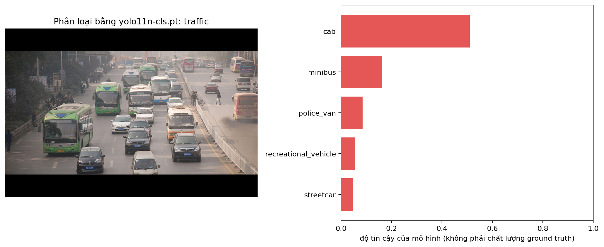
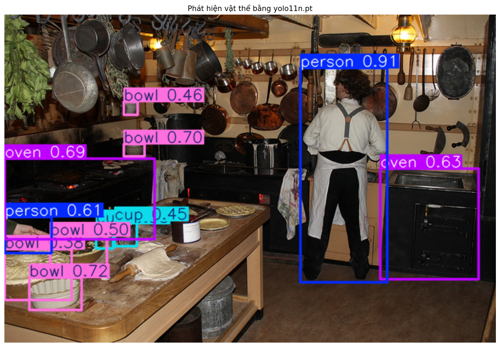
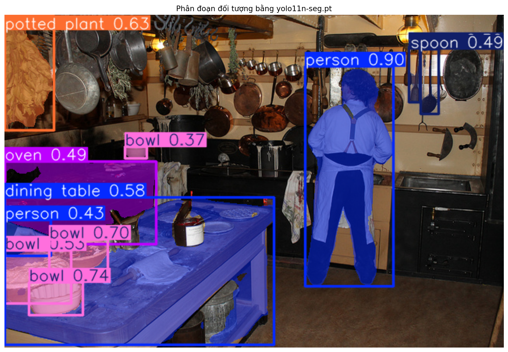

# Báo cáo bài thực hành Ngày 1 – Đọc prediction YOLO11 để hiểu định dạng nhãn

**Ngày chạy:**

**Runtime:** Notebook theo workflow Google Colab; CPU/GPU thực tế chưa được ghi trong output lưu

**Python / PyTorch:** chưa ghi nhận trong output lưu; **Ultralytics:** `8.4.145` (theo JSON)

**Checkpoint:** `yolo11n-cls.pt`, `yolo11n.pt`, `yolo11n-seg.pt`

**Ngưỡng detection/segmentation dùng khi tạo JSON:** `0.35` (chỉ đổi nếu GV cho phép; nếu đổi hãy ghi rõ)

**Thay đổi so với notebook nguồn:** Không ghi nhận thay đổi mã notebook; báo cáo đã được điền

**Thông tin tái lập từ artifacts:**
- Checkpoint và SHA-256: `yolo11n-cls.pt` — `c62d41bf9625777760018bf914d2e6cd472420ccd01706d97a61cb6c82502bd7`; `yolo11n.pt` — `0ebbc80d4a7680d14987a577cd21342b65ecfd94632bd9a8da63ae6417644ee1`; `yolo11n-seg.pt` — `55ed65c56c91713d23e8402371c6c49a6fd84f257f7dce452e8d70e41dcbe152`.
- Sample: `traffic` (COCO image `210273`, classification); `kitchen` (COCO image `397133`, detection và segmentation); ảnh `640×428` và `640×427` px tương ứng.
- Threshold tạo JSON cho detection/segmentation: `0.35`; device được notebook tự chọn (`GPU` nếu CUDA khả dụng, nếu không thì `CPU`), nhưng device thực chạy chưa có trong output lưu.

> **Cách dùng mẫu này:** copy/điền trên máy, lưu thành `REPORT.md`, rồi **upload** vào panel Files
> của Colab (notebook không tự tạo file này). Ô cuối Colab sẽ đóng ZIP cùng `day1_lab_outputs`.
> Giải nén và đưa vào `report/` trên GitHub, rồi nộp **link repo** trên LMS.
> Không ghi họ tên, MSSV, email, số điện thoại hoặc dữ liệu cá nhân khác vào báo cáo/output;
> họ tên/MSSV chỉ nằm trong tên repository.

### Từ cần nhớ (đọc nhanh trước khi viết)

| Từ | Nghĩa ngắn |
| --- | --- |
| Prediction | Kết quả model vừa đoán ra; chưa phải nhãn đúng |
| Ground truth | Nhãn do người gán theo quy tắc |
| Taxonomy | Danh sách tên lớp có sẵn kèm model (vd. ImageNet-1K, COCO-80) |
| Checkpoint | File model `.pt` đã huấn luyện sẵn |
| Guideline | Quy tắc gán nhãn do người viết |
| Annotator | Người gán nhãn |
| Reviewer / QC | Người kiểm tra nhãn |
| Escalation | Ca khó → hỏi Lab Coach, không tự bịa |
| Model score | Số “tin” của model; không phải điểm chất lượng nhãn người |

## 1. Phân loại ảnh

**Mở file:** `day1_lab_outputs/classification_predictions.json` và `day1_lab_outputs/visuals/classification_top5.png`.  
Chỉ dùng ảnh `sample_id = traffic`, lấy dòng `rank = 1`.

1. Chép record hạng 1: `class_id`=… ; `class_name`=… ; `rank`=1 ; `score`=… ; `taxonomy_name`=…
2. Record này nói về **cả bức ảnh** hay về **một vật thể riêng** trong ảnh? Vì sao bạn nghĩ vậy?
3. Danh sách tên lớp (class list) do đâu mà có: model tự nghĩ ra, hay đi kèm taxonomy/checkpoint?
4. Vì sao cần ghi cả `class_id`, `class_name` và `taxonomy_name`, không chỉ ghi mỗi tên lớp?
5. Nếu trong ảnh có nhiều vật / nhiều chủ đề, guideline cần nói rõ điều gì để người gán nhãn chọn **một** lớp?
6. Vì sao không được lấy `score` của model làm ground truth?

Bài Làm

1. 
```
{
    "sample_id": "traffic",
    "coco_image_id": 210273,
    "image_width": 640,
    "image_height": 428,
    "task": "image_classification",
    "taxonomy_name": "ImageNet-1K",
    "model_file": "yolo11n-cls.pt",
    "model_sha256": "c62d41bf9625777760018bf914d2e6cd472420ccd01706d97a61cb6c82502bd7",
    "ultralytics_version": "8.4.145",
    "rank": 1,
    "class_id": 468,
    "class_name": "cab",
    "score": 0.510915
  },
```
2. Đây là nhãn cho cả bức ảnh: record trả về lớp dự đoán và score, không có tọa độ hay box xác định vị trí từng vật thể.
3. Danh sách lớp và ánh xạ ID–tên đi kèm taxonomy/checkpoint đã huấn luyện; model không tự tạo tên lớp mới khi dự đoán.
4. Ba trường có vai trò khác nhau: `class_id` là mã lớp trong taxonomy, `class_name` là tên dễ đọc của lớp đó, còn `taxonomy_name` cho biết bộ lớp/qui ước phân loại đang dùng. Ghi đủ giúp diễn giải đúng ID và tránh nhầm giữa các taxonomy có thể dùng mã khác nhau.
5. Cần nêu rõ trong guideline rằng khi có nhiều vật hoặc chủ đề trong ảnh, người gán nhãn phải chọn **một** lớp chính đại diện cho nội dung chính của ảnh hoặc theo một quy ước nhất quán. Điều này giúp đảm bảo tính nhất quán và tránh nhầm lẫn trong quá trình gán nhãn.
6. Không được lấy `score` làm ground truth vì đây chỉ là độ tin cậy của prediction do model tạo ra, không phải nhãn đã được người gán nhãn xác nhận. Ground truth phải được tạo theo guideline và được kiểm tra; score chỉ có thể giúp ưu tiên ca cần review. 


## 2. Phát hiện vật thể

**Mở file:** `day1_lab_outputs/detection_predictions.json` và `day1_lab_outputs/visuals/detection_predictions.png`.  
Chỉ dùng ảnh `sample_id = kitchen`. Chọn **một** record.  
Số lượng prediction theo ngưỡng: xem output ô so sánh `0.20` / `0.35` / `0.60` trong notebook.

1. Chép một record: `class_name`=… ; `score`=… ; `bbox_xyxy`=[…, …, …, …] ; `bbox_width`=… ; `bbox_height`=…
2. Giải thích box bằng lời thường: góc trên-trái ở đâu, góc dưới-phải ở đâu, rộng/cao bao nhiêu pixel?
3. Chọn hai ngưỡng (vd. 0.20 và 0.60). Mỗi ngưỡng có bao nhiêu prediction?
4. Khi hạ ngưỡng (giữ nhiều hộp hơn), người **reviewer** phải làm thêm việc gì?
5. Viết **một quy tắc box** để người gán nhãn làm theo (áp dụng được cho nhiều ảnh, không chỉ ảnh này).
6. Trên ảnh `kitchen`, chỉ ra **một** vật bị che khuất hoặc cắt mép. Bạn sẽ viết thành quy tắc trong guideline, hay đưa lên hỏi Lab Coach (escalation)? Vì sao?


Bài làm:

1.
```json
{
  "sample_id": "kitchen",
  "coco_image_id": 397133,
  "image_width": 640,
  "image_height": 427,
  "task": "object_detection",
  "taxonomy_name": "COCO-80",
  "model_file": "yolo11n.pt",
  "model_sha256": "0ebbc80d4a7680d14987a577cd21342b65ecfd94632bd9a8da63ae6417644ee1",
  "ultralytics_version": "8.4.145",
  "score_threshold": 0.35,
  "class_id": 0,
  "class_name": "person",
  "score": 0.912625,
  "coordinate_unit": "pixel",
  "bbox_format": "xyxy",
  "bbox_xyxy": [385.33, 69.24, 498.92, 348.92],
  "bbox_width": 113.58,
  "bbox_height": 279.68
}
```
2. `bbox_xyxy` theo thứ tự `[xmin, ymin, xmax, ymax]`, đơn vị pixel: góc trên-trái là `(385.33, 69.24)`, góc dưới-phải là `(498.92, 348.92)`. Box rộng khoảng `113.6` px (JSON ghi `113.58` px) và cao khoảng `279.7` px (JSON ghi `279.68` px); chênh lệch nhỏ là do tọa độ và kích thước được làm tròn riêng.
3. JSON được lưu với ngưỡng `0.35` và có **11 prediction** cho ảnh `kitchen`; trong số đó, **6 prediction có score ≥ 0.60**. Hạ ngưỡng có thể giữ thêm prediction, còn số chính xác ở ngưỡng thấp hơn không thể khôi phục từ JSON chỉ lưu kết quả ở `0.35`.
4. Khi ngưỡng thấp hơn và có nhiều hộp hơn, reviewer phải xem thêm các hộp, phát hiện hộp trùng hoặc false positive, kiểm tra lớp và chỉnh box lệch; score thấp chỉ giúp ưu tiên review chứ không tự quyết định nhãn đúng/sai.
5. **Quy tắc box:** Vẽ một hình chữ nhật nhỏ nhất bao trọn phần nhìn thấy của đúng một vật thể; đặt cạnh box sát biên ngoài vật thể, không bao phần bị che khuất hoặc vùng nền không thuộc vật thể. Nếu vật thể chạm mép ảnh, box dừng tại mép ảnh.
6. Ở góc dưới bên trái ảnh `kitchen` có một người bị cắt bởi mép trái; prediction `person` có score `0.610931`, box bắt đầu gần mép trái (`xmin = 0.12`). Trường hợp chỉ thấy một phần nhỏ cơ thể cần escalation nếu guideline chưa quy định phần tối thiểu để nhận diện `person`; trong lúc chờ, đánh dấu cần review, không tự suy đoán phần bị khuất.

## 3. Phân đoạn theo từng đối tượng

**Mở file:** `day1_lab_outputs/segmentation_predictions.json` và `day1_lab_outputs/visuals/segmentation_prediction.png`.  
Chỉ dùng ảnh `sample_id = kitchen`. Chọn **một** record.
1. Chép một record: `instance_id`=… ; `class_name`=… ; `score`=… ; số điểm polygon=`polygon_point_count`=… ; 3–5 điểm đầu của `polygon_xy`=…
2. So với box, polygon cho thêm thông tin gì về hình dạng vật thể?
3. `instance_id` dùng để làm gì? Nó **không** phải class ID và **không** phải tracking ID — bạn hiểu câu này thế nào?
4. Viết **một quy tắc vẽ biên mask** để người gán nhãn làm theo.
5. Trên ảnh `kitchen`, chỉ ra **một** chỗ biên mờ / hai vật chạm nhau / bị che. Bạn dùng guideline hay escalation? Vì sao?


Bài làm:

1.
```json
{
  "sample_id": "kitchen",
  "coco_image_id": 397133,
  "image_width": 640,
  "image_height": 427,
  "task": "instance_segmentation",
  "taxonomy_name": "COCO-80",
  "model_file": "yolo11n-seg.pt",
  "model_sha256": "55ed65c56c91713d23e8402371c6c49a6fd84f257f7dce452e8d70e41dcbe152",
  "ultralytics_version": "8.4.145",
  "score_threshold": 0.35,
  "instance_id": "kitchen-005",
  "class_id": 60,
  "class_name": "dining table",
  "score": 0.578416,
  "coordinate_unit": "pixel",
  "bbox_format": "xyxy",
  "bbox_xyxy": [0.97, 234.74, 345.86, 423.87],
  "polygon_point_count": 598,
  "polygon_xy": [[251.0, 399.0], [252.0, 400.0], [252.0, 401.0], [253.0, 402.0], [254.0, 402.0]]
}
```
2. Box chỉ biểu diễn vùng chữ nhật bao vật thể; polygon mô tả đường biên nên cho thấy phần hình dạng thực tế, ví dụ các góc, cạnh xiên và phần không chiếm hết box. Với `dining table`, box rộng lớn còn polygon bám theo đường viền bàn; polygon vì vậy hỗ trợ kiểm tra vùng pixel thuộc bàn chính xác hơn.
3. `instance_id` định danh một vật thể cụ thể trong ảnh để nối mask với lớp và ghi nhận quyết định review. Ví dụ `kitchen-005` là một instance bàn; một instance khác cùng là `dining table` sẽ có ID khác. `class_id` mới cho biết loại lớp, còn tracking ID dùng để nối cùng vật thể qua nhiều khung hình video; dữ liệu này là ảnh tĩnh nên `instance_id` không làm các việc đó.
4. **Quy tắc mask:** Vẽ polygon kín theo đường biên nhìn thấy của từng vật thể; tại chỗ bị vật khác che, dừng theo ranh giới phần nhìn thấy, không vẽ xuyên qua vật che. Reviewer kiểm tra mask có lấn sang vật bên cạnh hoặc nền không.
5. Trên ảnh `kitchen`, mask `dining table` (`kitchen-005`, score `0.578416`) ở vùng mặt bàn chạm các vật đặt trên bàn và khu vực cạnh thùng kim loại dưới bàn; biên cần được rà kỹ vì overlay khiến khó xác định mask có tràn sang vật khác hay không. Dùng guideline đã nêu để chỉ giữ pixel thuộc phần bàn nhìn thấy; nếu ranh giới vẫn không thể phân biệt bằng ảnh thì đánh dấu review/escalation và hỏi Lab Coach, không tự quyết lớp hay biên.

**Quy tắc guideline và QC rút ra từ hai ảnh:** Annotator vẽ box hoặc mask quanh phần nhìn thấy theo đúng đơn vị nhãn và quy tắc nhất quán; không dùng score làm nhãn. Reviewer đối chiếu từng prediction với ảnh gốc, kiểm tra vật bị bỏ sót, nhãn sai, box/mask thừa, trùng hoặc lệch biên. Ca chỉ khó ở ranh giới thì áp dụng guideline; ca chưa rõ định nghĩa lớp hoặc không đủ thông tin thì đánh dấu review và hỏi Lab Coach.

## 4. Vòng đời và kiểm tra chất lượng

Lab hôm nay chỉ **xem prediction**. Chuỗi dưới đây là vòng đời production để bạn nối các khái niệm:

`ảnh thô → guideline → ground truth → huấn luyện → prediction → QC/rework`

Điền bảng (viết ngắn, có dẫn chứng từ JSON/PNG khi nói về lỗi):

| Tác vụ | Ground truth trông như thế nào? (đơn vị nhãn) | Lỗi hoặc chỗ khó quyết định bạn thấy trên ảnh/JSON | Annotator làm gì? | Reviewer xem gì? |
| --- | --- | --- | --- | --- |
| Phân loại ảnh | Một nhãn lớp cho cả ảnh, gồm `class_id` và `class_name` theo taxonomy đã chọn. | Ảnh `traffic` có nhiều chủ thể nhưng prediction hạng 1 chỉ chọn `cab` (`class_id: 468`, `score: 0.510915`, taxonomy `ImageNet-1K`). Score là độ tin cậy của model, không xác nhận nhãn đúng; ảnh nhiều chủ thể cũng cần quy tắc chọn lớp chính. | Làm theo guideline để chọn một lớp đại diện nhất quán cho nội dung ảnh; dùng đúng taxonomy và đánh dấu ca mơ hồ để hỏi Lab Coach, không lấy score làm ground truth. | Đối chiếu ảnh với nhãn, kiểm tra lớp chính có theo guideline không, `class_id`/`class_name` có khớp taxonomy không và các ca mơ hồ đã được xử lý chưa. |
| Phát hiện vật thể | Một bản ghi cho mỗi vật thể: `class_name` cùng một hộp `bbox_xyxy` bao quanh vật thể. | Ở ảnh `kitchen`, JSON có prediction `person` score `0.912625`, box `[385.33, 69.24, 498.92, 348.92]`. Box chỉ là hình chữ nhật nên có thể chứa nền hoặc lệch khỏi biên; các prediction điểm thấp hơn ngưỡng cũng có thể bị bỏ sót, còn hạ ngưỡng sẽ tăng hộp cần kiểm tra. | Gán đúng lớp và vẽ box sát phần nhìn thấy theo cùng một quy tắc; vật bị che thì chỉ bao phần nhìn thấy. Ca không rõ lớp cần đánh dấu review/escalation. | Kiểm tra vật thể bị bỏ sót hoặc box thừa/trùng, lớp có đúng không, box có bao đúng phần nhìn thấy không; kiểm tra các ca bị che/cắt mép và các prediction điểm thấp. |
| Instance segmentation | Một mask/polygon cho từng vật thể, gắn `instance_id` riêng trong ảnh và `class_name`; chỉ vùng pixel thuộc vật thể được tô. | Ở phần 3, mask `dining table` trên ảnh `kitchen` có vẻ tràn sang thùng kim loại dưới gầm bàn. Đây là biên hai vật chạm nhau, nên cần tách phần nhìn thấy của từng vật và tránh mask chồng lấn. | Vẽ mask kín, bám biên phần nhìn thấy; mỗi vật có instance riêng, loại phần nền/lỗ nhìn thấy khỏi mask. Theo guideline khi đã rõ quy tắc; đánh dấu review hoặc hỏi Lab Coach nếu không xác định được lớp hay biên. | So mask với ảnh ở mức pixel: kiểm tra thiếu/thừa vùng, biên có lấn sang vật khác không, mask có kín và không tự cắt nhau/chồng lấn không, đồng thời xác nhận class và instance ID. |

## 5. An toàn dữ liệu

1. Quy tắc bảo vệ dữ liệu của bạn cho bài lab này là gì? (viết 1 câu)
2. Nếu gặp ảnh hoặc dữ liệu không đúng phạm vi, bạn sẽ dừng và báo cho ai?

Bài làm:
1. Chỉ sử dụng ảnh và dữ liệu phục vụ bài lab, không đưa thông tin cá nhân hoặc dữ liệu nhạy cảm vào báo cáo/output, và không chia sẻ dữ liệu ra ngoài phạm vi lớp học.
2. Dừng xử lý ảnh hoặc dữ liệu đó, không tải lên hay chia sẻ thêm, rồi báo cho giảng viên hoặc Lab Coach để được hướng dẫn.

## 6. Checklist trước khi nộp link repo

Kiểm tra trên GitHub trong thư mục `report/`:

- [x] `REPORT.md` (file này đã điền)
- [x] `day1_lab_outputs/classification_predictions.json`
- [x] `day1_lab_outputs/detection_predictions.json`
- [x] `day1_lab_outputs/segmentation_predictions.json`
- [x] `day1_lab_outputs/IMAGE_ATTRIBUTION.md`
- [x] `day1_lab_outputs/visuals/classification_top5.png`
- [x] `day1_lab_outputs/visuals/detection_predictions.png`
- [x] `day1_lab_outputs/visuals/segmentation_prediction.png`
- [ ] Ô validation cuối notebook báo `PASS`
- [x] Không có họ tên, MSSV hoặc dữ liệu nhạy cảm trong báo cáo/output
- [ ] Đã nộp **link repository** trên LMS
